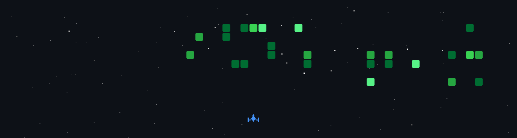

<div align="center">


<br/>

<h1>
  
</h1>

[](https://github.com/rafael-robsonn)


<br/>

[](https://linkedin.com/in/rafael-robson)&nbsp;
[](mailto:rafaelrobsonnunesdearaujo@gmail.com)&nbsp;
[](https://github.com/rafael-robsonn)

<br/>


</div>

<br/>

---

<table>
<tr>
<td width="52%" valign="top">

### `> whoami`

```
role   : CEO, Chesin
focus  : AI-native data engineering
base   : Brasília, DF — Brazil
study  : Data Science & ML @CEUB
status : building
```

I founded **Chesin** with two bets one automates data pipelines with AI, the other reinvents urban mobility with intelligent electric fleets.

No demos. Real systems.

</td>
<td width="48%" valign="top">

### `> ls ./now`

```python
currently = {
  "shipping" : "DataSM v1 — Decision Layer",
  "training" : "ART v-carbon",
  "target"   : "≥ 85% code acceptance rate",
  "reading"  : "Designing ML Systems",
  "open_to"  : [
    "data engineering roles",
    "AI/ML engineering",
    "founding team"
  ],
}
```

</td>
</tr>
</table>

<br/>

---

## ◈ Featured Work

<br/>

<table>
<tr>
<td width="60%" valign="top">

### ⬡ DataSM &nbsp; `[flagship]`

> **AI agent that writes, reviews and deploys production data pipelines without a human in the loop.**

Built on a **dual-brain architecture**: LangGraph orchestrates the full pipeline while Claude acts as an adversarial Reviewer, catching hallucinations and enforcing schema correctness before anything touches production. A Decision Layer (replacing the broken weighted-blend merge) arbitrates between agent outputs. dbt + BigQuery as the initial wedge.

**North star metric: ≥ 85% code acceptance rate.**

```
User intent
    │
    ▼
[LangGraph Orchestrator]
    ├── Codestral (Generator)
    ├── Claude (Reviewer / Critic)
    └── Decision Layer
            │
            ▼
    [dbt → BigQuery] ── Production
```


</td>
<td width="40%" valign="top">

### ⬡ ChesinBus

> **Intelligent fleet management for hybrid and electric buses.**

Real-time telemetry ingestion, route optimization, and predictive maintenance at scale. Built for the operational complexity of emerging markets where data is sparse and downtime is expensive.

<br/>


<br/><br/>

### ⬡ gemma-cli

> Rust CLI with full streaming, runtime flags and 4 subcommands (`ask` `chat` `models` `info`) integrating Gemma 4 E4B via Ollama locally.


</td>
</tr>
</table>

<br/>

<table>
<tr>
<td width="60%" valign="top">

### ⬡ ART &nbsp; `[new]`

> **Typed decision model: it picks an option, and also knows when not to.**

Started as a fine-tune of a multilingual base with longer context (2k), better zero-shot and calibrated option scoring, without giving up inference speed. **ART v-carbon** is the standalone rewrite: built on mmBERT-base, distilled from the v3 teacher, with kernels ported to TileLang. On top of plain classification it adds abstention, explanations, counterfactuals, batching with cache, multi-criteria scoring and uncertainty reporting.

Released as freeware under the **LART** license: no commercial use, no modification, no reverse engineering.


[`ART-v1`](https://github.com/rafael-robsonn/ART-v1)

</td>
<td width="40%" valign="top">

### ⬡ Esmalteria Bot

> **Conversational scheduling assistant for a nail salon, wired to Trinks.**

Reads real availability, matches service to professional, books and confirms. Built around the messy parts of salon scheduling: services split between professionals, duration blocks and manual reshuffles when someone is out.

<br/>


</td>
</tr>
</table>

<br/>

<table>
<tr>
<td width="50%" valign="top">

### ⬡ kestrel-mm &nbsp; `[rust]`

> **Statistical market maker, ITCH 5.0 bytes to quote in ~163 ns.**

ITCH 5.0 feed into an L3 order book, SIMD microstructure features (OFI, VPIN, micro-price), an extended Kalman filter for fair value and a GBDT toxicity model, quoting through Avellaneda-Stoikov. Zero heap allocation on the hot path, enforced by a counting-allocator test. `unsafe` limited to the SPSC ring and the TSC clock. Property tests check the book against a reference implementation.

**5.96 M msg/s** on the 3-thread pipeline, pinned cores.


[`kestrel-mm`](https://github.com/rafael-robsonn/kestrel-mm)

</td>
<td width="50%" valign="top">

### ⬡ almgren-abm-rl &nbsp; `[rust]`

> **Optimal execution with recurrent PPO on an agent-based limit order book.**

Deterministic discrete-event exchange with five agent types, validated against stylized facts, plus an Almgren-Chriss baseline calibrated on the simulator itself. A GRU actor-critic trained with PPO in `burn`, all in one Rust process with no Python boundary. On 2,048 held-out episodes the policy beats the calibrated baseline by 0.49 bps of implementation shortfall (paired, 9.9 standard errors). Limitations and training-seed spread are reported in the repo.


[`almgren-abm-rl`](https://github.com/rafael-robsonn/almgren-abm-rl)

</td>
</tr>
</table>

<details>
<summary><b>↳ more projects</b></summary>

<br/>

| Project | Description | Stack |
|---|---|---|
| **Language Quest** | Gamified language learning — progression system, adaptive quizzes, real-time feedback | React, TypeScript |
| **Java Forum App** | Full MVC application — auth, threads, points system, end-to-end tests | Java, Spring, PostgreSQL, DBUnit, Selenium |
| **DataSM Code Review** | Automated code review dashboard — dual-agent pipeline (Reviewer + Critic), 5-stage WebSocket flow | React, Python, WebSocket |
| **nlp-regras-basico** | Study notes: BoW, TF-IDF, Word2Vec, GloVe, RNN, LSTM, GRU + NLPortugues/USP labs | Python, PyTorch |
| **DER-DF Traffic EDA** | Exploratory analysis of ~6.5M traffic infractions across 83 CSVs, incremental aggregation so it runs on a laptop | Python, pandas, Jupyter |
| **Quantum ML Lab** | Hybrid QCNN on FashionMNIST plus VQC, QAOA and quantum-kernel SVM. Controlled protocols, ablations and null results reported as they came out | PennyLane, PyTorch |
| **TaskTracker** | Task manager in 3 phases: logic design, Git workflow, Docker | Python, Docker |
| **Tessera Rivs AI** | Hackathon build grown into a full app: React front wired to 44 FastAPI routes, i18n, settings drawer, audit chain | React, FastAPI |
| **War Modpack** | Minecraft LAN modpack where each friend runs a nation: trade, raids, alliances, final war. Tuned to run on 8 GB RAM | Minecraft |

</details>

<br/>

---

## ◈ Hackathons

<br/>

<table>
<tr>
<td width="50%" valign="top">

<div align="center">

### Transforming Enterprise Through AI

**`Tessera`**

</div>

> *"The trust layer for enterprise AI agents."*

Real-time multi-agent threat chain detection with LGPD compliance enforcement and cryptographically-signed audit trails. Policy engine with regulatory basis, DPO settings, RoPA (Art. 37), health checks, and a SOC-grade dark UI built for long analyst sessions. Threat severity classification with audit blockchain verification.

<br/>


</td>
<td width="50%" valign="top">

<div align="center">

###  AMD Developer Hackathon

**`TokenBurners`**

</div>

> *"We burn tokens so you don't have to."*

Automated code review system powered by adversarial AI. Dual-agent pipeline (Reviewer + Critic) in 5 stages with real-time feedback via WebSocket. Issues classified by severity critical, major, minor, suggestion — with per-file stats and tree visualization. AMD ROCm dark mode UI.

<br/>


</td>
</tr>
</table>

<br/>

---

## ◈ Stack

<div align="center">

<br/>

[](https://github.com/rafael-robsonn)

[](https://github.com/rafael-robsonn)

[](https://github.com/rafael-robsonn)

<br/>

</div>

<details>
<summary><b>↳ full breakdown</b></summary>

<br/>

| Layer | Technologies |
|---|---|
| **AI / LLM** | LangChain, LangGraph, RAG, LSTM/GRU, LLM Fine-tuning, Codestral, Claude API |
| **Data Engineering** | Apache Spark, dbt, BigQuery, PostgreSQL, SQL, ETL/ELT |
| **Languages** | Python, Scala, Java, Rust, TypeScript, COBOL |
| **Backend** | FastAPI, Spring Boot, Node.js, REST, MVC |
| **Frontend** | Javascript, React, TypeScript, HTML/CSS |
| **BI** | Power BI |
| **CLOUD** | AWS, GCP, AZURE |
| **Infra** | Docker, Git, Maven, Tomcat, DBUnit, Selenium, Terraform |

</details>

<br/>

---
## ◈ Stats

<div align="center">
 <br/>
  


<div align="center">

<br/>



---

<div align="center">

<sub>systems that work when no one's watching</sub>

<br/><br/>


</div>
